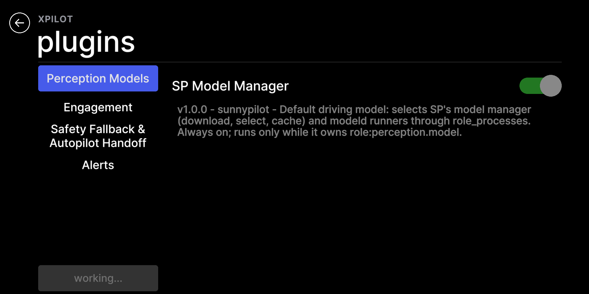
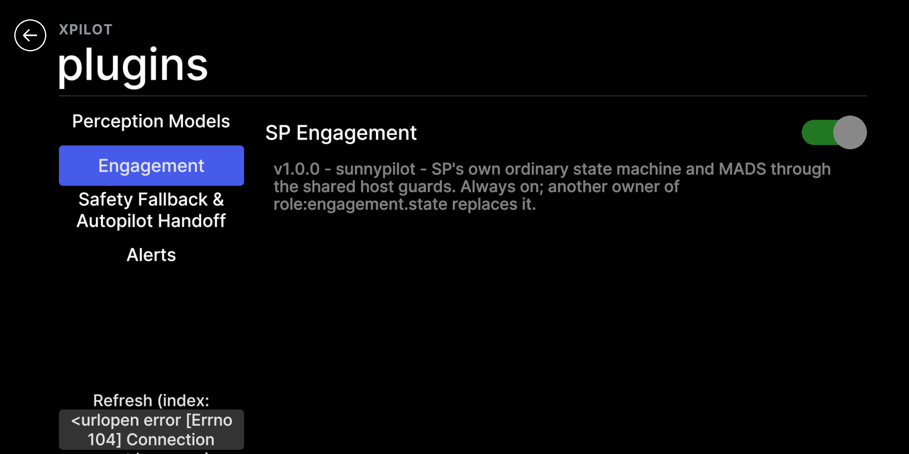
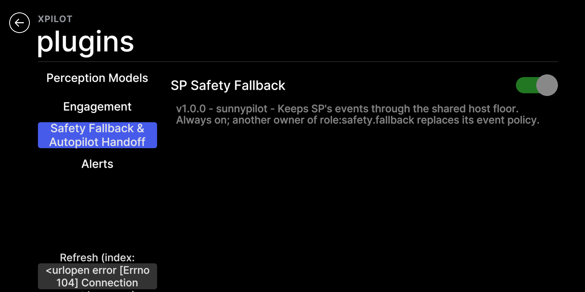

# REPORT X-20261024-08

status: **FAILED**。目标 369b1e95c83f2e35530129d385fab44bedbce03e 已实际部署、构建和验证，但商店实机检查失败，默认路径回放也有差异。按失败回退规则，设备已恢复到开始时的 **65bb09e3d5d306487d005f15cef799e31cf37fa2**，原 xpilot 分支和 comma.service 均已恢复。候选版本没有继续部署运行。未修改产品源码。

(a) PASS；(b) 首次启动 FAIL、恢复后 120 秒复测 PASS，因此本报告保守记 FAIL；(c) FAIL；(d) FAIL；(e) PASS；(f) PASS（目标源码副本在设备真实 GPU 上的独立 UI 检查）。文档提交与设备活动提交分开；本报告只提交在 task/X-20261024-08，文档提交 SHA 由该任务分支的 Git 提交确定。

**身份、来源与变更边界**

| 项目 | 当前证据 |
|---|---|
| 唯一设备 | comma@172.16.1.202，hostname comma-9c13c9f5 |
| 硬件 / 系统 | /data/hardware_profile=c3xl；AGNOS 19.9 |
| 实际活动路径 | /data/openpilot → /data/xpilot-agnos19.9-20261025/candidate |
| 设备开始提交 / 分支 | 65bb09e3d5d306487d005f15cef799e31cf37fa2 / xpilot |
| 候选来源 | github.com/onemiless/xpilot，git fetch xpilot 后 task/X-20261024-int=369b1e95c83f2e35530129d385fab44bedbce03e |
| 回放基线 | 65bb09e3d5d306487d005f15cef799e31cf37fa2 |
| 共享 Mac checkout | /Users/mile/Desktop/mo-op/artifacts/xpilot-install-20261022/source；始终保持 xpilot、65bb09e、干净，无 reset/clean |
| 本轮文档 worktree | /Users/mile/work/wt/X-20261024-08，task/X-20261024-08，从候选 HEAD 创建 |
| 插件仓库 | github.com/onemiless/xpilot-plugins，main=723e9312bb89a8b6cf58a1a081d38dfc6219cd74 |
| SSH/SCP/rsync | 全部 StrictHostKeyChecking=yes、UpdateHostKeys=no、BatchMode=yes；没有改连接或网络配置 |
| 实测日期 | 2026-10-24 UTC / 2026-10-25 Asia/Taipei；目录日期保留任务指定的 20261024 |

先读 AGENTS.md、XPILOT.md、v8/v9 报告与其 preflight、Panda 只读、部署、参数恢复和 GPU 截图脚本。使用 ponytail，失败模式先记在本机 FAILURE-MODES.txt；只新增本报告目录，不增加产品实现或单元测试。设备起始 dirty 只有空 prebuilt；与 22 个候选更新路径无交集，文件哈希最终不变。插件仓库副本全部文件与 Mac 相等，文件数和 SHA-256 在 evidence/plugins-copy-proof.json。

已阅读七个提交：

| 提交 | 内容 |
|---|---|
| 0343a8b | 商店更新失败恢复旧版本、停车检查 |
| a85cc27 | CI 保存结果和两仓库提交 |
| 37fcd2b | 进程注册隔离、拒绝核心重名、SERVICES 校验、active services、发送故障处理 |
| 40a02f2 | safety.profile 的清单解析与生成检查 |
| 45f25c7 | perception.model owner 通过 role_processes 选择 SP 模型进程 |
| 9383401 | 所有默认 owner 也经过 core_host；窄 fallback、MADS option A、Tesla CardGate 始终启用 |
| 369b1e9 | 必需角色、关闭/卸载保护、停车缺失角色提醒 |

精确 git diff --stat 65bb09e..369b1e9：**22 files，1003 insertions，176 deletions**，见 evidence/source.diffstat。没有 C/C++/头文件、capnp、cereal、panda 或 opendbc_repo 改动，未触发禁止部署的源文件门。没有修改 safety.json 或生成的固件注册表。

**部署、构建、Panda 与安全**

采用已核对的 bundle 传输和 ff-only 部署。bundle SHA-256 为 46c0ced8cbbf850989240ec8549b21df998a595a6a91cbb7f7224c51c0cdb586；主机和设备相同，git bundle verify 通过。设备保留 task-X-20261024-08-before 指向实际起点，并保留 refs/task/X-20261024-08-target 指向候选。原生 SCons 直接执行，没有依靠 prebuilt 标记跳过构建。

| 项目 | 结果 |
|---|---|
| 候选 scons -j4 | rc=0；real 17.81 / user 18.31 / sys 7.41 秒 |
| 回退 scons -j4 | rc=0；real 13.82 / user 11.74 / sys 1.67 秒 |
| 固件版本，部署前 / 候选构建后 / 最终 | 全部 DEV-65bb09e3-DEBUG |
| Panda serial / raw type / 应用态 | 1d002d000a51303436323838 / 09 / 非 bootstub |
| 固件文件 SHA-256，三次 | 5a355ba276e85419a5f21542836820562d4c23b7a522a0bf6d635f0328821470 |
| 128-byte 签名 | 运行签名＝构建预期签名，部署前、启动前、回退后、最终均完全一致；全文见 panda-before/post-build/final.json |
| 最终安全 | IsOffroad=true，IsEngaged=false，deviceState.started=false，controls_allowed=false，ignition_line=false，ignition_can=false，faults=0，fault_status=0 |
| 最终物理 CAN 计数 | 三路 total_tx_cnt 均为 0；SPI error count=0 |

Panda 只使用 PandaSpiHandle 的 get_info/controlRead 与 Panda.__new__ 绑定读取方法；没有调用 Panda.__init__/connect、flash、recover、controlWrite 或 can_send。**新构建预期签名先与运行 Panda 比对通过，才启动候选服务。** 回退后再次通过相同签名门才恢复服务。回放 sendcan 是独立 msgq 命名空间的日志消息，没有连接 pandad 或物理 CAN。

首次服务启动没有进入 manager：/usr/comma/comma.sh 检查 /tmp/booted 和累计 touch_count，日志为 launching system reset, got taps，停在 reset --tap-reset 页面；读取计数为 68。没有触摸或确认该页面。停止该服务实例后，在已经存在 /tmp/booted 的正常入口重试，manager 正常启动。原始记录见 evidence/initial-startup-failure.log。这是系统启动入口问题，不能归因为候选插件源码，但首次启动失败仍计入 (b)。

恢复后的候选生产窗口 **120.004219 秒**，239 个 manager 快照，原有 13 个停车运行进程均持续运行，PID 各只有一个值。在 manager 工作目录独立导入的全部 47 个 managed_processes 注册名在 base/head 一致；实际生产 managerState 的 47 个名称也逐项相同。最初从仓库根导入时只有 46 个，因为 process_config.py:153 按工作目录检查 copyparty-sfx 文件；最后已在两棵树的 manager 目录复核，保留原始根目录导入证据；在转成字典前也检查 procs 无重复。生产 stdout 与 logMessage/errorLog 同时采集；窗口和启动日志中没有 traceback、插件导入/加载错误或 XpilotPluginFaults 条目。模型目录公网请求出现 ConnectionResetError(104)，进程使用已有缓存继续运行。完整摘要及逐进程 PID 集合见 evidence/production-summary.json，完整原始消息保留在外部证据目录。

**失败模式与检查退出码**

| 模式 | 结果 | 证据与边界 |
|---|---|---|
| a 构建失败 / 预期 Panda 固件变化 | PASS | 候选构建 rc=0，完整签名及固件 SHA 不变，启动前先比较 |
| b manager / 名称 / 重复 / 120 秒生产错误 | FAIL；复测 PASS | 首次被系统 reset 入口拦住；恢复后 config / runtime 均 47 名称一致、无重复，120.004 秒无上述错误 |
| c 全部既有检查与 E2E | FAIL | store_check、store_e2e 的真实 Params 异常；big_screen 原断言失败，未修改检查或安装插件补环境 |
| d 默认路径 frame-by-frame | FAIL | selfdriveState 第 51–5972 帧的 state/enabled/active 不同；其他捕获输出相同 |
| e 宿主额外 p99 >200 µs | PASS | p99 差 21.77051 µs；成对样本额外 p99 51.97653 µs |
| f 默认核心插件页与缺失角色提醒 | PASS，独立 GPU 范围 | 三类截图、默认开关不可关闭且为开、missing_roles=[]；没有 No role:... plugin 告警 |

下列是**原样脚本在设备真实 Python/原生 Params 环境**的 rc：

| 脚本 | rc |
|---|---:|
| agnos_update_check.py | 0 |
| manifest_check.py | 0 |
| offroad_pages_check.py | 0 |
| phase2_check.py | 0 |
| phase3_check.py | 0 |
| phase4_check.py | 0 |
| plugin_host_check.py | 0 |
| safety_manifest_check.py | 0 |
| store_check.py | **1** |
| tile_layout_check.py | 0 |
| static_imports.py | 0 |
| big_screen_e2e.py | **1** |
| store_e2e.py，插件 main 723e931 | **1** |
| gen_params.py --check | 0 |
| gen_safety.py --check | 0 |

补充驱动：overhead.py rc=0；core-ui.py 首次 rc=1、修正验证脚本分类名后 rc=0；六个 base/head 进程回放全部 rc=0；compare-replay.py rc=1。完整检查 rc 表见 evidence/checks.tsv；失败日志保留原文。

**回放输入、隔离与逐帧比较**

指定 Tesla 段 aebd8f1d4ea16066|000002d8--5850d3ea5c--2，来自仓库 openpilotci get_url 对应的 rlog.zst。输入 SHA-256：1770f70d8f8053e5b1984ed4f9d704be8d58f6d55b59cafd6aa11109aaf777c1。

候选构建完成后，按要求 rsync --exclude=.git 复制到 /data/xp-replay-base，再仅将 git diff --name-only 65bb09e..369b1e9 的 22 个路径替换为 git show 65bb09e:path 原始字节；无其他基线源码替换。84 个 .so/.a/.o/.signed 构建文件逐个 SHA 相同，见 native-shared-hashes.json；两棵树使用同一次原生构建。基线没有 .git，因此驱动向两边提供同一份从候选取得的 build metadata，避免无 Git 的基线无法初始化。

回放前保存真实参数原始字节，并生成同一份 147-key typed 参数输入，SHA-256 为 1152339da5e9257d04f899dbf99e82a5ad6d1ab13883d4579d7be0f7cd8217ff。车辆身份、CarParams/CarParamsSP 等由仓库同一回放指纹回调从该段构建；移除的身份/瞬态键及仓库根据日志覆盖的 UbloxAvailable、AlphaLongitudinalEnabled 等规则完整记录在 methods/prepare-replay.sh 和仓库 generate_params_config。私密参数值没有提交。使用空的独立 store 目录确保是 SP 默认角色路径，保留其余相同用户设置。

服务停止后，仓库 process_replay 为每个进程建立独立 OpenpilotPrefix、/dev/shm/params 和 msgq。没有启动 manager/pandad，也没有设置真实 IsOffroad、点火或车辆状态。仓库的 SIMULATION/REPLAY 仅在隔离子进程中使用。首次基线回放因 config_realtime_process(4, ...) 遇到停车 CPU 4 离线，报 OSError errno 22；保留 attempt1-base。正式两边统一映射到同一个在线核心 3（在线集合 0–3），不改变 CPU 在线状态或调频参数，实时优先级调用保留。

为满足 SP 输出和 CardGate 输入，驱动在 selfdrived 配置追加捕获 selfdriveStateSP/onroadEventsSP；controlsd 捕获 carControlSP。controlsd/card 两边都使用同一份 **base selfdrived** 输出，card 同时使用同一份 base controlsd 输出。card.pubs 增加 selfdriveState，真实发送给 CardGate 自己的 SubMaster；不是把 alive() 改成 True。因输入已补齐，两边 sendcan 均为 5,922 条且逐帧相同，不存在“新 gate 没有输入所以不发”的误判。

这是每个进程在相同输入下的回归比较。controlsd/card 的相等结果不表示整条 head 链路收到自身不同的 selfdriveState 后仍会输出相同控制；本轮已经因 selfdrived 差异失败，没有作此推断。

使用仓库 compare_logs，**tolerance=0**，比较捕获配置中的全部 12 种输出消息，不忽略消息类型或非时间行为字段。全部忽略字段只有以下四项：

1. logMonoTime：日志时间戳。
2. carState.cumLagMs：card 的 Ratekeeper 延迟计时。
3. controlsState.deprecated.cumLagMs：弃用的延迟计时字段。
4. controlsState.deprecated.startMonoTime：弃用的起始时间戳字段。

| 进程 / 消息 | base / head 条数 | 不同帧数 |
|---|---:|---:|
| selfdrived / selfdriveState | 5973 / 5973 | **5922** |
| selfdrived / selfdriveStateSP | 5973 / 5973 | 0 |
| selfdrived / onroadEvents | 62 / 62 | 0 |
| selfdrived / onroadEventsSP | 61 / 61 | 0 |
| controlsd / carControl，含 enabled、latActive、longActive、全部 actuators | 5973 / 5973 | 0 |
| controlsd / controlsState | 5973 / 5973 | 0 |
| controlsd / carControlSP | 5973 / 5973 | 0 |
| card / sendcan | 5922 / 5922 | 0 |
| card / carState | 5972 / 5972 | 0 |
| card / carOutput | 5972 / 5972 | 0 |
| card / carParams | 2 / 2 | 0 |
| card / radarTracks | 1194 / 1194 | 0 |

合计每棵树比较 49,050 条消息；其中指定必比六类为 23,964 条。selfdrived 12,069 条输出中 5,922 条不同，controlsd 17,919 条与 card 19,062 条全部相同。所有完整日志、每个输出 SHA 和全部差异在外部 replay 目录；提交目录保留完整计数和最先五帧差异。

首个差异是 **0-based frame 51**（第 52 条 selfdriveState），两边 logMonoTime 都是 491598328250：

| 字段 | base | head |
|---|---|---|
| selfdriveState.state | enabled | disabled |
| selfdriveState.enabled | true | false |
| selfdriveState.active | true | false |

同样三个字段一直不同到 frame 5972。结合源码推断：selfdrived.py:549–550 在 REPLAY 初始化时按 Panda 已允许控制恢复 enabled；core_host.py:137–138 的新门要求首次 enabled 有本帧驾驶员 ENABLE，而该截段已在接管中。此解释与初始化 dt=0.51 秒及首差 frame 51 对应，属于源码结合回放的归因，不能当作道路实测结论。没有忽略 state/enabled/active、跳过前若干帧或注入 ENABLE 来改变验收结果。

**开销与 GPU 截图**

使用真实 SP StateMachine 和 ModularAssistiveDrivingSystem；wrapped 通过默认核心插件的 core_host.install，bare 直接使用 SP 实例。Mads=1、MadsMainCruiseAllowed=1、MadsSteeringMode=0、DisengageOnAccelerator=0；空 Events/EventsSP、disabled、vEgo=10、cruise available。每组先暖机 1,000 次，再各测 10,000 次 update + mads.update 成对调用；交替先后顺序，perf_counter_ns，计时段关闭 GC，退出恢复。断言两边仍 disabled 且没有插件 fault。只验证这一确定输入，不声称测得全部状态的最坏耗时。

| µs / 一对 update | p50 | p99 |
|---|---:|---:|
| bare SP | 93.485 | 125.932 |
| wrapped | 115.880 | 147.70251 |
| 成对 extra 样本 | 22.08250 | 51.97653 |

wrapped p99 − bare p99 = **21.77051 µs**，低于 200 µs 门槛；成对额外 p99 也低于门槛。原始 20,000 个计时值在外部 overhead-samples.json，摘要在 evidence/overhead.json。

首次核心页截图驱动将实际分类 Perception Models 写成单数，导致 next() 失败，未改变产品代码。该错误发生在目标已因 (c)/(d) 失败并回退的流程中。为补齐截图，保留 base 副本，cp -al 创建 head-ui-tree，仅原子替换同样 22 个目标文件并校验 SHA；没有改动活动树或基线副本。暂停基线服务后在此目标源码副本运行真实 BigScreenHost / PluginsPage / GPU，退出后恢复参数与基线服务。它证明目标页面渲染，不冒称候选仍在生产部署。

| 页面 | 文件 | 原始 PNG 字节 |
|---|---|---:|
| Perception Models / SP Model Manager | screenshots/sp_models.png | 325568 |
| Engagement / SP Engagement | screenshots/sp_engagement.png | 334954 |
| Safety Fallback & Autopilot Handoff / SP Safety Fallback | screenshots/sp_safety_fallback.png | 325780 |
| 停车磁贴 | screenshots/tiles.png | 188390 |

全部原图小于 400,000 bytes，无缩放或有损压缩。已逐张目视核对三张核心页：开关为开、控件不可关闭、角色和说明正确。程序断言 missing_roles=[]、LOAD_ERRORS={}，没有 No role:... plugin 告警。截图时有既有 Unsupported branch HEAD 告警（当时的回退过渡态）及公网索引错误，均不属于缺失角色；之后已恢复原 xpilot 分支。

**编号问题**

1. **阻止保留部署：商店使用未注册的 IsOnroad。** openpilot/tesla/store.py:131、170 调用真实 Params.get_bool，openpilot/common/params_keys.h:63 只注册 IsOffroad，最终抛 UnknownKeyName: b'IsOnroad'。store_check 在 :231 进入安装时失败，store_e2e 在 :82 第一次安装前失败。不能把使用 CoreParams stub 的宿主检查成功当成真实 Params 证明。没有安装/移除真实 store 插件来绕过问题。
2. **阻止保留部署：默认 selfdrived 回放状态不等。** core_host.py:137–138 与 selfdrived.py:549–550 的已接管回放初始化衔接不等，首差 frame 51，三个字段共 5,922 帧不同。门的安全要求与回放初始条件如何衔接需要源码任务处理；本轮不移除门或放宽比较。真实道路影响尚未验证。
3. **既有大屏 E2E 的当前设备前置条件不满足。** tools/sp_tesla_e2e/big_screen_e2e.py:331–332 报 no data tile to drag。已执行 22 个 case，当前真实商店只有 overspeed_warning，没有可拖动数据磁贴。未安装默认磁贴、未改原脚本；因此整项 c 仍失败，单独核心角色截图通过不能替代完整 E2E。
4. **首次服务启动进入系统 reset 提示页。** /usr/comma/comma.sh 的 /tmp/booted/touch_count 分支阻断 manager。未确认 reset，停服务后正常入口重试恢复。初次启动失败计入 b，复测 120 秒无 manager/插件错误。
5. **公网模型目录和商店索引连接重置。** 候选生产日志模型刷新报 ConnectionResetError(104)，继续使用已有缓存；截图 Plugins 页索引同样报 Errno 104，Refresh 文本溢出按钮可见。动态标签来自 openpilot/tesla/ui/pages/plugins.py:106的 refresh_button。没有改网络配置，也没有证明公网在线下载/刷新正常；不把它解释为插件加载失败。

**参数、商店与最终恢复**

最初对 /data/params/d 和 /data/xpilot_plugins/.params 的全部 156 个文件保存存在性、原始字节和 SHA。每个隔离测试阶段之后恢复；最终启动前再次恢复全部 156 个文件，逐文件字节相等。原始参数副本只保存在设备及本机 private 目录，没有提交令牌、账号或原始参数内容。store_e2e 自己的安装动作只使用其临时目录；真实 store 的 7 个原始文件、所有商店参数和 prebuilt 哈希均不变。

运行服务后，配置参数仍与初始值相同；六项由正常服务生成的系统记录重新写入：BootCount、CurrentBootlog、LastUpdateTime、UpdaterAvailableBranches、UpdaterLastFetchTime、UptimeOffroad。最终仍是 156 个文件，详见 evidence/preservation-final.json。**没有将服务运行后的整个参数目录描述为逐字节静止不变。** TileLayout、BMS、CarPlatformBundle、IsDriverViewEnabled、AlphaLongitudinalEnabled 等用户配置及全部 store 参数没有差异。

先 checkout 精确回退 SHA 并原生重建；为恢复原分支与更新目标，确认 HEAD=65bb09e、xpilot=369b1e9 且候选保留 ref 存在后，停止服务，使用带旧值校验的 git update-ref 恢复设备本地 xpilot 指针，再 checkout xpilot。活动文件内容和已重建提交不变，没有 reset/clean、没有网络 Git push、没有删除候选提交。最后恢复参数、通过 Panda 签名/健康门、启动服务，再以新鲜消息通过五秒安全门。发布前复核时间为 2026-10-24T19:36:05Z UTC。

验证驱动中的额外错误均保留：初版只读门误读 IsOnroad；首轮 CPU affinity errno 22；首次核心页分类拼写；最终参数分类调用 all_keys(PERSISTENT) 返回不可 UTF-8 解码字节，改为从 params_keys.h 读取分类，并显式验证只有已确认的系统生成记录变化。这些不是通过修改产品实现或伪造 Params 让原样检查通过；原样失败 rc 没有被覆盖。

没有驾驶或接管、没有车辆点火模拟、没有 Panda flash、物理 CAN 发送、数据 reset、网络/SSH 配置修改；未确认重启、关机、reset 或卸载。big_screen 自带 synthetic onroad 只作用于独立 UI 的内存布局，真实 IsOffroad 始终为 1。

**证据与复核**

| 路径 | 内容 |
|---|---|
| 本目录 evidence/、screenshots/、methods/、result.json | 签名、安全快照、完整检查 rc、失败日志、12 类比较摘要、开销、核心页原图和执行方法 |
| /Users/mile/work/artifacts/X-20261024-08 | Mac 完整原始证据、输入 rlog、bundle、执行日志、v8/v9 参考及 private 参数备份 |
| /Users/mile/work/artifacts/X-20261024-08/device/replay | base/head 六份压缩输出、全部差异、子进程 stdout/stderr、首轮失败 |
| /data/xpilot-X-20261024-08-evidence | 设备原始证据、原始参数快照、同版本插件副本、head-ui-tree |
| /data/xp-replay-base | 保留的基线源码 + 同一次原生构建；没有激活 |
| evidence/external-artifact-hashes.json | 未入 Git 的原始结果内容 SHA-256；所有结果对应本报告锁定的两个源码提交 |

安全的离线证据复核命令，每行一条：

    cd docs/validation/xpilot-c3xl-20261024
    shasum -a 256 -c SHA256SUMS
    python3 verify-artifacts.py

methods 是本轮设备操作和隔离验证的执行记录；部署、停服及参数恢复脚本有本轮专用路径和前置 SHA，不能把离线证据复核误认为重新运行设备测试。重新采集须重新通过当前设备安全门、使用新的证据路径，并保持相同输入、参数、源码和原生构建；不应覆盖本轮失败证据。文档撤销用 git revert 对应文档提交，不影响设备回退状态。

**NOT RUN**：onroad engagement；实体 MADS 按钮；全部封闭场地项目；真实车辆上的 host/card 挂死退出时延和控制闭环。

最终活动提交：**65bb09e3d5d306487d005f15cef799e31cf37fa2，xpilot，comma.service active/running**。目标 369b1e95c83f2e35530129d385fab44bedbce03e 未保留运行。
